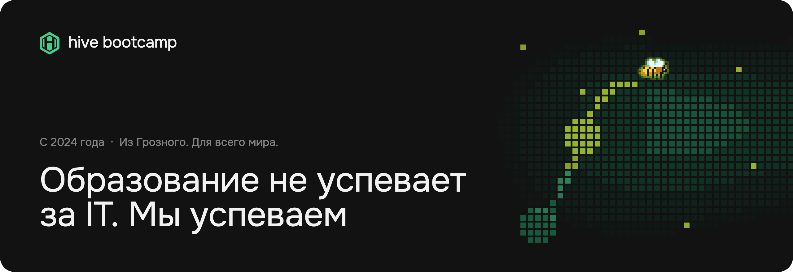

  <a href="https://hivebootcamp.ru/ru?utm_source=github&utm_medium=org_profile&utm_campaign=nav">Сайт</a>
  &nbsp;·&nbsp;
  <a href="https://hivebootcamp.ru/ru?utm_source=github&utm_medium=org_profile&utm_campaign=nav#enroll">Записаться</a>
  &nbsp;·&nbsp;
  <a href="https://t.me/hivebootcamp">Telegram</a>
  &nbsp;·&nbsp;
  <a href="https://hivebootcamp.ru/hire?utm_source=github&utm_medium=org_profile&utm_campaign=nav">Нанять выпускника</a>

Онлайн-буткемп из Грозного. С 2024 года учим взрослых программированию с нуля и готовим к работе в IT. Учёба устроена как в команде разработки: спринты, ревью кода, созвоны и ментор рядом.

## Курсы

| Курс                                                                                                            | Стек          | Срок      |
| --------------------------------------------------------------------------------------------------------------- | ------------- | --------- |
| [Backend](https://hivebootcamp.ru/ru/backend?utm_source=github&utm_medium=org_profile&utm_campaign=courses)     | Go, API       | 4 месяца  |
| [DevOps](https://hivebootcamp.ru/ru/devops?utm_source=github&utm_medium=org_profile&utm_campaign=courses)       | CI/CD, Docker | 3 месяца  |
| [Fullstack](https://hivebootcamp.ru/ru/fullstack?utm_source=github&utm_medium=org_profile&utm_campaign=courses) | React, NestJS | 13 недель |

Ближайшие потоки и цены на [сайте](https://hivebootcamp.ru/ru/pricing?utm_source=github&utm_medium=org_profile&utm_campaign=courses), там же рассрочка. Не знаешь, что выбрать: на главной есть тест из пяти вопросов про обычную жизнь, Go тебе ближе или DevOps.

## Как проходит курс

1. Подготовка. Пока ждёшь старта, бесплатно разбираешь базовые понятия и первые задачи.
2. Спринты. Поток стартует вместе, у каждого спринта свой срок сдачи.
3. Ревью кода. Домашку сдаёшь через merge request. Через пару минут после push первые замечания оставляет AI, засчитывает работу ментор.
4. Зачёт голосом. После спринта отвечаешь вслух, как на собеседовании. AI предлагает оценку, решает ментор.
5. Сертификат. Обычный или с отличием, по итогам задач.

## Кто рядом

AI помнит, ментор ведёт, группа тянет. AI-ментор объясняет непонятный кусок урока в любое время, хоть в 23:40. Ментор видит твой прогресс и пишет первым, если ты буксуешь. С группой вы на связи в Talk, мессенджере, который мы сделали сами: там чат и созвоны с записью и конспектом.

## После курса

Карьерный центр (отдельная услуга): резюме, профессиональная легенда, мок-собеседования с ментором и тренажёр собеседования с AI. В банке школы 3 757 вопросов с настоящих собеседований в 32 компаниях. 24 из них с эталонными ответами [открыты всем](https://hivebootcamp.ru/ru/interview-questions?utm_source=github&utm_medium=org_profile&utm_campaign=career), попробуй ответить сам.

## Работодателям

Подберём Go-, Fullstack- или Frontend-разработчика среди студентов и выпускников: стажировка, фриланс или штат. Для работодателей бесплатно. [Оставить заявку](https://hivebootcamp.ru/hire?utm_source=github&utm_medium=org_profile&utm_campaign=hire)

## Что в репозиториях

Учебные проекты студентов: сервисы на Go, REST API, работа с базой данных и тесты.
